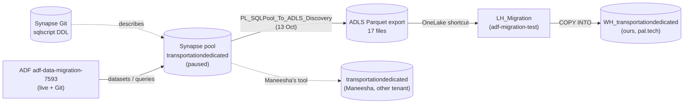
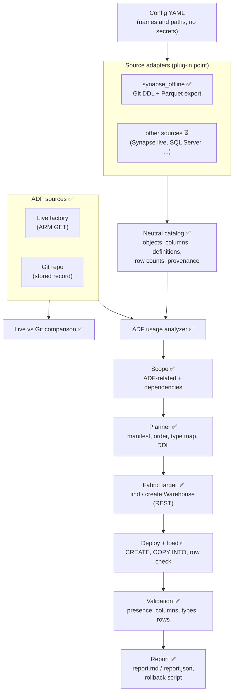

# Warehouse migration to Microsoft Fabric: architecture and work done

This document explains the warehouse migration framework in this repository: what it does, how it is built, what has
been run, and what is still open. It covers the work completed on 15 Oct 2026.

**In one paragraph.** One command, `adf2fabric warehouse-migrate`, migrates a **source data warehouse** into a
**Microsoft Fabric Warehouse**. It is not written for one warehouse. It works in six steps:
1. It **discovers** the source through a pluggable source adapter.
2. It reads Azure Data Factory **from both the live factory and the Git repository** and compares the two.
3. It works out which warehouse objects ADF **uses, plus everything those objects depend on**.
4. It creates those objects in Fabric with Fabric-compatible types.
5. It **loads the data**.
6. It **validates** the result and writes a report.

The design accepts any source warehouse. **Today the only source adapter is the Synapse dedicated SQL pool**, used
offline (see §5). This repo claims no other source until an adapter is built and tested.

- Code: `src/adf2fabric/agent/warehouse/`
- Tests: `tests/test_warehouse.py`
- Evidence notes from the assessment: [docs/warehouse-assessment.md](docs/warehouse-assessment.md)

**Status legend:** ✅ built and tested · 🟡 partial · ⏳ not built · ⛔ blocked

---

## 1. Goal and rules

**Goal:** migrate a warehouse "as is" (same schemas, tables, columns, views, procedures and data) into Fabric. Take
the objects ADF relates to plus their dependencies, and make every decision visible in a report.

**Rules the framework enforces:**

| Rule | How |
|---|---|
| Read-only unless told otherwise | `warehouse-assess` only reads. `warehouse-migrate` writes only with `--apply` **and** `target.read_only: false`. |
| Never create a Warehouse by accident | A missing Warehouse is created only with `--create-warehouse` **and** `target.create_if_missing: true`. |
| Never overwrite data | Conflict policy `fail` (default) stops before any change if a planned object exists. `skip` leaves existing objects alone. `if_empty` only loads tables that are still empty. Nothing is dropped, truncated or replaced. |
| Never touch the source | The source is only read. Synapse and ADF calls are reads: GET requests and SELECT statements. |
| Secrets never travel | Passwords, credential secrets, SAS signatures and account keys in source SQL are masked before parsing. Config files reject secret-like keys. Tokens come from the Azure CLI and are never written anywhere. |
| No invented facts | Every fact carries its provenance (`verified`, `inferred`, `missing`, `needs_live`). Inferred values are reported as such. |
| Undo is possible | Every run that creates objects writes a `rollback-<time>.sql` (DROP statements in reverse order). The framework never executes it. |

## 2. The environment

| Part | What it is |
|---|---|
| Source warehouse | Synapse workspace `transportationmigration`, dedicated SQL pool `transportationdedicated` (DW100c). **Paused; it cannot be resumed (subscription constraint).** |
| Source definitions | Synapse Git repo `maneesha26625/synapse-migration-project`, `sqlscript/` at commit `bfb7ed0`. The scripts target a pool named `TransportDW`. |
| Source data | 17 Parquet files exported on 13 Oct 2026 by ADF pipeline `PL_SQLPool_To_ADLS_Discovery`. They are in storage account `datamigrationadftofabric`, container `migrationcontainer`, folder `migration-test/parquet/`, named `<schema>_<object>.parquet`. |
| ADF | Factory `adf-data-migration-7593` (subscription `dbd817b4…`, resource group `adf_to_fabric`), Git repo `Synapse_to_adf` at `360e17a`. It has 12 pipelines, 25 datasets and 6 linked services. |
| Fabric (ours) | Tenant pal.tech (`1680abbe…`), workspace `adf-migration-test`. Lakehouse `LH_Migration` has a shortcut `Files/migrationcontainer` to the storage container. **Warehouse `WH_transportationdedicated`** was created by this work. |
| Fabric (Maneesha's) | Tenant `436c36aa…` (we have guest access), workspace `Synapse_to_Fabric`, Warehouse `transportationdedicated`, migrated earlier by her own tool. We only read it. |



## 3. Architecture



### Components

| Component | File | Status | What it does |
|---|---|---|---|
| Models | `models.py` | ✅ | Catalog, ADF references, manifest entries, checks, report. All strict pydantic. |
| Source-adapter contract | `adapter.py` | ✅ | The `SourceAdapter` protocol and a registry: adapters register by name, and the config picks one. |
| Synapse offline adapter | `adapters/synapse_offline.py` | ✅ | Parses Synapse `sqlscript/*.json` DDL and reads the Parquet export (§5). |
| Secret masking | `secrets.py` | ✅ | Masks secrets in SQL before anything is parsed or stored. |
| ADF live + Git | `adf_sources.py` | ✅ | Reads the live factory (ARM GET, paged), parses it with the same parsers as Git, and compares the two. |
| ADF usage analyzer and scope | `dependencies.py` | ✅ | Finds ADF references to warehouse objects, classifies usage, and selects the scope (§6). |
| Type and T-SQL rules | `typemap.py` | ✅ | Source type to Fabric type, plus review flags for view and procedure code (§7). |
| Planner | `planner.py` | ✅ | Manifest, dependency order and CREATE TABLE DDL. |
| Fabric items | `fabric_items.py` | ✅ | Finds the workspace and Warehouse by name, and creates a Warehouse on request (Fabric REST). |
| Target reader | `target_fabric.py` | ✅ | Reads a Fabric Warehouse inventory over its SQL endpoint with SELECT only. Uses an Entra token for the target's tenant, so cross-tenant guest access works. |
| Deploy and load | `deploy.py` | ✅ | Preflight, create schemas, tables, views and procedures, load, row-count check, run log, rollback script. |
| Validation | `validate.py` | 🟡 | Presence, columns, types and row counts. View and procedure **text** is not compared. |
| Report | `report.py` | ✅ | Markdown report. The JSON report is the `MigrationReport` model. |
| Orchestration | `agent.py` | ✅ | `analyze` → `run` (assess) / `migrate` / `repoint_pipelines`. |
| Pipeline repoint | `repoint.py` | ✅ | Points Fabric pipeline activities that read the old warehouse connection at the Fabric Warehouse, and fixes Fabric T-SQL issues in their queries (§9.3). |
| Config | `config.py` | ✅ | YAML schema. Rejects secret-like keys. |
| CLI | `cli.py` | ✅ | `warehouse-assess`, `warehouse-migrate` and `warehouse-repoint`. |

The framework reuses these pieces that already existed in the repo:
- the ADF semantic parsers and the stored ADF record (`agent/discovery/adf_semantic`, `project/store.py`);
- the ARM URL helper (`agent/discovery/adf/arm.py`);
- the Fabric REST client, with retry, long-running operations and a "token only goes to Fabric" guard (`agent/deployment/fabric_deploy.py`);
- the Azure CLI token provider (`connections/providers/azure_cli.py`);
- secret-key detection (`connections/redaction.py`).

## 4. What `warehouse-migrate` does, step by step

```
adf2fabric warehouse-migrate --config <file>                              # dry run: discover, plan, check target
adf2fabric warehouse-migrate --config <file> --apply                      # create + load + validate
adf2fabric warehouse-migrate --config <file> --apply --create-warehouse   # also create the Warehouse if missing
```

| # | Step | Detail |
|---|---|---|
| 1 | Discover the source | The adapter named in `source.adapter` returns a neutral `SourceCatalog`. |
| 2 | Read ADF | It reads the **live factory** (`adf.live`) and the **Git record** (`adf.project`) and compares them. Live is used for the analysis, because it is what actually runs. If live can't be read, the run falls back to Git and the report says so. |
| 3 | Find ADF usage | It takes dataset tables, query text, catalog Lookups feeding a ForEach, stored-procedure activities and parameter defaults, then classifies each object (§6). |
| 4 | Select scope | `scope.mode: adf_related` (default) selects objects ADF uses plus their definition dependencies, both ways. `all` takes everything. Every object is listed as in or out, with the reason. |
| 5 | Plan | It maps types, drops Synapse-only options, generates DDL, and orders the work: schemas, tables, functions, views, procedures. |
| 6 | Find or create the target | It looks up the workspace and Warehouse by name. It creates the Warehouse only when allowed (§1). |
| 7 | Preflight | It reads what already exists in the target and applies the conflict policy **before** any change. |
| 8 | Create and load | It runs CREATE SCHEMA, CREATE TABLE, CREATE VIEW and CREATE PROCEDURE. After each table it runs **COPY INTO** and checks that the target row count equals the source; the first failure stops the run. |
| 9 | Validate | It reads the target again, then checks presence, columns, types and row counts for every in-scope object. |
| 10 | Report | It writes `report.md`, `report.json`, `catalog.json`, `ddl-dry-run.sql`, `dependency-graph.json` and `rollback-<time>.sql` to `projects/<project>/warehouse/`. |

`warehouse-assess` runs steps 1–5 and 9 against an existing Warehouse and never writes. We used it to check Maneesha's Warehouse.

## 5. Source adapters

**Interface** (`adapter.py`): `source_type`, `mode`, `capabilities()` and `discover() -> SourceCatalog`. An adapter
registers itself with `adapter.register("<name>", factory)` and is imported in `adapters/__init__.py`. Nothing
after discovery knows which platform the source is.

**`synapse_offline` (built):**
- **Reads:** Synapse Git `sqlscript/*.json`. It skips serverless (`Built-in`) scripts, and `pools` can restrict which pools are read.
- **Parses:** CREATE TABLE, EXTERNAL TABLE, VIEW, PROCEDURE, FUNCTION, INDEX, MASTER KEY, EXTERNAL DATA SOURCE and DATABASE SCOPED CREDENTIAL. It also reads the Synapse options (DISTRIBUTION, CLUSTERED COLUMNSTORE INDEX, CLUSTERED INDEX, HEAP, partitioning) and counts seed INSERTs.
- **Reads from the Parquet export:** row counts, labelled with the export they came from. Objects that exist only in the export (no DDL) get their columns **inferred** from the Parquet schema.
- **Cannot know offline:** live row counts, statistics, security, functions not in Git, and the real types of export-only objects.

**Adding a new source** (for example Synapse live, Azure SQL, SQL Server or another warehouse):
1. Write a class with the four members above that fills a `SourceCatalog` (objects, columns, definitions, row counts, provenance).
2. Register it and import it in `adapters/__init__.py`.
3. Add a fixture test like the ones in `tests/test_warehouse.py`.
4. If the data can't be exported to Parquet for COPY INTO, add a load method in `deploy.py`.

A live Synapse adapter was deliberately **not built**: the pool can't be resumed, so it could never be tested for real.

## 6. ADF analysis and scope

**Live vs Git.** Both go through the same parsers, and the parsed models are compared. Empty defaults that ARM adds and
derived fields are ignored. **Result: live and Git match: 12 pipelines, 25 datasets, 6 linked services, 0 differences.**

**References found** (only for SQL linked services: `AzureSqlDW`, `AzureSqlDatabase`, `SqlServer`, …):

| Reference | Example here | Resolution |
|---|---|---|
| Dataset with a literal schema/table | `DS_SQL_DimVendor` → `dw.DimVendor` | static |
| Dataset with expression schema/table | `DS_SQL_DynamicTable` | dynamic |
| SQL dataset with no table | `DS_SQL_DimCabType` | broken |
| Object names in a literal query | `PL_SQL_Data_Assessment/Count_*` | static |
| Query built by an expression | `PL_SQLPool_To_ADLS_Discovery/Copy data1` | dynamic |
| ForEach over a `sys.objects … type IN (…)` Lookup | the export pipeline: every U, V and ET object | dynamic (scope known) |
| Names in a parameter default | `PL_ControlFlow_Test.TableList` (Wait activities only) | mentioned |

**Usage per object:**
- `direct`: a static reference.
- `dynamic`: reached only at run time.
- `indirect`: used by a view or procedure that ADF uses.
- `mentioned`: named in a parameter only.
- `standalone`: no reference.

**Scope `adf_related`:**
- **Start:** every `direct` and `dynamic` object.
- **Repeat until nothing changes:** add the objects a selected view or procedure reads, and add the views and procedures that read a selected object.
- **Never selected:** server-level objects (master key, data source). They are reported as manual.

**Result here: 19 objects in scope, 0 out.**
- 9 objects are direct: 6 dimension tables, the fact table, and 2 stage tables.
- 8 are dynamic, because the export pipeline enumerates every table, view and external table.
- The 2 procedures are in because they read the in-scope views.

**ADF facts found along the way:**
- ADF has 5 pipelines and 10 datasets that our team added. They are not in the original Synapse workspace, which has 7 pipelines and 15 datasets. They are part of the migration by decision.
- `DS_SQL_DimCabType` lost its table in ADF; the Synapse original points to `dw.DimCabType`.
- `PL_Spark_Test` runs two Synapse notebooks in Synapse but two Wait activities in ADF. ADF can't run Synapse notebooks; it was rebuilt properly in Fabric earlier.

## 7. SQL compatibility rules (`typemap.py`)

| Source | Fabric Warehouse | Evidence |
|---|---|---|
| `datetime` / `smalldatetime` | `datetime2(3)` / `datetime2(0)` | observed in a migrated Warehouse |
| `tinyint` | `smallint` | observed |
| `int IDENTITY` | `bigint`, IDENTITY dropped, source values loaded | observed |
| `datetime2(7)`, `time(7)` | precision 6 | documented |
| `money` / `smallmoney` | `decimal(19,4)` / `decimal(10,4)` | documented |
| `nchar` / `nvarchar(n)` | `char` / `varchar(2n)` (UTF-8) | documented, check |
| `text`, `ntext` / `image` | `varchar(max)` / `varbinary(max)` | documented |
| `datetimeoffset` | `datetime2(6)` (offset lost) | documented |
| no equivalent (xml, geography, …) | manual | documented |
| string with unknown length (inferred) | `varchar(8000)` (`default_varchar_length`) | flagged for review |
| DISTRIBUTION, CCI, CLUSTERED INDEX, indexes, partitioning | dropped, listed as transformations | documented |
| PRIMARY KEY / UNIQUE | not generated; reported (add as `NOT ENFORCED` if needed) | documented |
| External tables, master key, data source, credential | **manual** (Fabric has no PolyBase): use a OneLake shortcut or a regular table | documented |

**Review flags for view and procedure code:**
- OPENROWSET and external tables;
- table WITH options;
- `OPTION (LABEL)`, `RENAME OBJECT`, `IDENTITY_INSERT`;
- `sys.pdw_*` views;
- cursors and triggers.

"Observed" means seen in Maneesha's migrated Warehouse on 15 Oct 2026. "Documented" rules come from Microsoft Learn
(Fabric Warehouse data types and T-SQL surface area). They were not re-checked in this work, so re-check them before
using them on a new source.

## 8. Loading

| Method | Status | How |
|---|---|---|
| `copy_into` (default) | ✅ used | `COPY INTO <table> FROM '<url>' WITH (FILE_TYPE = 'PARQUET')`. The URL comes from `loading.source_url_template`; here it is the OneLake path through the `LH_Migration` shortcut, so no storage key or SAS is needed. |
| `insert_from_parquet` | ✅ tested | Batched parameterized INSERTs from the local export. For small tables, or when the Warehouse can't reach the storage. |
| Live copy from the source | ⏳ | Not built: the pool can't be resumed. |

After every load, the target row count must equal the source count; otherwise the run stops at that table.

## 9. What was run and the results

### 9.1 Check of Maneesha's Warehouse (read-only, cross-tenant)

| Result | Objects |
|---|---|
| match | 11 tables, 2 views, 2 procedures |
| review | `dw.SalesByCityProduct`: string lengths unknown offline |
| differs | `operation.PipelineRunLog`: 21 rows exported vs 38 in Fabric. The 17 extra rows are Fabric runs logged on 14 Oct, not a migration error. |
| manual | 2 external tables, master key, external data source |
| only in her Warehouse | 5 load procedures and a staging table `migration_load.dw__DimLocation` |

### 9.2 Our migration into `WH_transportationdedicated` (pal.tech, `adf-migration-test`)

**What was created:**
- **Warehouse:** `WH_transportationdedicated`, created by the framework on 15 Oct 2026 at 11:30 UTC.
- **Objects:** 3 schemas (`dw`, `stage`, `operation`), 13 tables, 2 views and 2 procedures.
- **Data:** 19,778 rows, loaded with COPY INTO from the Parquet export through the OneLake shortcut.

**Checks, all passing:**
- **Row counts:** every table's count equals the source.
- **Validation:** all 17 schema objects match: presence, columns, types and rows.
- **Views and procedures:** both views and both procedures execute and return the expected counts.
- **Fact totals:** `dw.FactCabTrip` matches the export exactly:
  - pickup range 2019-01-01 00:07 to 2019-03-31 23:46;
  - `SUM(TotalAmount)` 320,168.17;
  - `SUM(PassengerCount)` 16,216.

**Rerun:**
- `warehouse-migrate --apply` was then run again on the same Warehouse with conflict policy `skip`.
- It read live ADF and Git (0 differences) and selected 19 objects.
- It found all 17 schema objects already present, **changed nothing**, and validated everything as `match`.

**Known differences from the source:**
- **Collation:** the Warehouse uses Fabric's default `Latin1_General_100_BIN2_UTF8`, which is case-sensitive. Synapse
  and Maneesha's Warehouse are case-insensitive. This was kept by decision. `target.collation` sets it for a new Warehouse.
- **Inferred string lengths:** the 3 export-only tables (`dw.SalesByCityProduct`, `stage.TaxiZoneLookup`,
  `operation.PipelineRunLog`) have `varchar(8000)` strings, because their real lengths are unknown offline.
- **External tables:** the 2 external tables and the master key / data source were not migrated (manual).

### 9.3 Pipelines moved onto the Warehouse (phase 7, 16 Oct 2026)

**Why.** The converted Fabric pipelines read the warehouse through the Fabric connection `Synapse_SQL`
(`d47b78d9…`, pointing to `transportationmigration.sql.azuresynapse.net;transportationdedicated`). The source pool
stays paused, so the pipelines must read the migrated Fabric Warehouse instead.

**What `warehouse-repoint` does.** For each pipeline in `repoint.pipelines`:
- It reads the definition and saves a **backup**.
- Every activity that reads through a connection in `repoint.from_connections` becomes a Warehouse read:
  - the source type becomes `DataWarehouseSource`;
  - the dataset becomes a `DataWarehouseTable`;
  - the dataset references the Warehouse by item id, endpoint and workspace id.
- Queries, schema/table and all other settings stay as authored.
- Queries that now run on the Warehouse get Fabric T-SQL fixes. Today the fix is putting reserved-word aliases in brackets: `AS RowCount` → `AS [RowCount]`. Fabric rejects the bare form, Synapse accepted it, and the column name stays the same.
- Sinks that write to the old warehouse are reported, not changed.
- It is a dry run unless `--apply` is given, and running it twice changes nothing.

**Result.** Both pipelines were repointed and run in Fabric:

| Pipeline | Result |
|---|---|
| `PL_SQL_Data_Validation` | 3 of 3 Lookups correct: 4,898 / 4,906 / 9,804 |
| `PL_SQL_Data_Assessment` | 9 of 9 Lookups correct (its `AS RowCount` aliases are bracketed by the T-SQL rule above) |

**Not repointed by decision:** `PL_SQLPool_To_ADLS_Discovery`. It exports every table to `migration-test/parquet/`. Pointed
at Fabric, it would overwrite the Parquet files that are this migration's source data. It stays on `Synapse_SQL`.

**Backups:** the original definitions are in `projects/transportationdedicated-to-fabric/warehouse/repoint/backup-*.json`.

## 10. Configuration

Example: [config/warehouse-migration.example.yaml](config/warehouse-migration.example.yaml). Real configs live under
`projects/<name>/`, which is git-ignored. This project uses `projects/transportationdedicated-to-fabric/warehouse-migrate.yaml`.

| Section | Keys |
|---|---|
| `source` | `adapter`, `database`, `options` (for `synapse_offline`: `scripts_dir`, `parquet_dir`, `export_label`, `pools`) |
| `adf` | `project` (Git record), `live` (`subscription_id`, `resource_group`, `factory`) |
| `scope` | `mode` (`adf_related` or `all`), `include`, `exclude`, `schema_map` |
| `target` | `tenant_id`, `workspace`, `warehouse`, `sql_endpoint` (for assess), `read_only`, `create_if_missing`, `collation` |
| `loading` | `method` (`copy_into` or `insert_from_parquet`), `source_url_template` (`{file}`, `{schema}`, `{name}`), `conflict_policy` (`fail`, `skip`, `if_empty`) |
| `repoint` | `pipelines`, `from_connections` (Fabric connection ids of the old warehouse), `workspace` (default: `target.workspace`) |
| top level | `project` (output folder), `default_varchar_length` |

## 11. Security

- **Secrets in source SQL are masked** before parsing; only their count is reported. Masked patterns:
  - `PASSWORD = '…'` and `SECRET = '…'`;
  - `PWD=`, `AccountKey=` and `SharedAccessSignature=`;
  - SAS `sig=`.

  A test plants a sentinel secret and checks that it appears in no output file. The master-key password committed in
  the Synapse repo stays there by the owner's decision; the framework never copies it.
- **Config files cannot hold secrets:** loading fails on secret-like keys.
- **Tokens:**
  - Azure CLI tokens are requested per tenant (`target.tenant_id`), so guest access to another tenant works.
  - ARM tokens are requested per subscription for ADF.
  - Tokens are never logged or written.
  - The Fabric client refuses to send a token to any host other than the Fabric API.
- **Raw ADF definitions** from ARM are held in memory only. Only parsed, secret-masked models are compared and stored.

## 12. How to run

```bash
pip install -e ".[warehouse,connectivity]"   # pyarrow, pyodbc, requests; plus ODBC Driver 18 for SQL Server
az login                                     # account with access to the target workspace and the factory
adf2fabric discovery-adf-semantic ...        # once, to store the ADF Git record (see README)

adf2fabric warehouse-assess  --config projects/<name>/warehouse-migration.yaml   # read-only check of an existing target
adf2fabric warehouse-migrate --config projects/<name>/warehouse-migrate.yaml     # dry run
adf2fabric warehouse-migrate --config ... --apply [--create-warehouse]           # migrate
adf2fabric warehouse-repoint --config ... [--apply]                              # point pipelines at the Warehouse

pytest tests/test_warehouse.py                # 43 tests, offline (fake ARM, fake Fabric, fake Warehouse)
```

**Outputs** go to `projects/<project>/warehouse/`:
- `report.md` and `report.json` (ADF sources, scope, objects, validation, deploy steps);
- `catalog.json`;
- `ddl-dry-run.sql`;
- `dependency-graph.json`;
- `rollback-<time>.sql`.

## 13. Tests

`tests/test_warehouse.py` covers:
- **secrets:** masking, and the sentinel test across all outputs;
- **DDL parsing:** tables, options, indexes, modules, external objects, serverless skipping, Parquet inference;
- **type rules;**
- **ADF:**
  - references: static, dynamic, broken, mentioned, and the catalog-Lookup ForEach;
  - the live fetch: GET only, pagination;
  - the live vs Git comparison;
- **scope selection;**
- **planner order and DDL;**
- **target inventory:** SELECT only;
- **validation;**
- **deploy:**
  - a dry run writes nothing;
  - `fail` refuses existing objects, `skip` and `if_empty` work;
  - a row-count mismatch stops the run;
  - the first failure stops the run;
  - the rollback script is written;
- **end-to-end `migrate`:** dry run, Warehouse creation with scope-only deploy, and a filled target with `skip`;
- **pipeline repoint:** Lookup, nested Copy, other connections untouched, sinks reported, reserved-alias fix, idempotent.

Related: the Spark work of `PL_Spark_Test` runs on Azure Databricks as external compute. The compute assessment
(Fabric CU sizing and Databricks cost) is described in [docs/compute-and-databricks.md](docs/compute-and-databricks.md).

## 14. Limits and open items

| Item | Status |
|---|---|
| Live Synapse adapter and live data copy | ⏳ not built: the pool can't be resumed, so it can't be tested. Add it through §5 when a live source exists. |
| View and procedure definition comparison | ⏳ only presence and execution are checked |
| External tables, master key, data source | Manual. Decide between a OneLake shortcut + view or a regular table. |
| Real DDL of the 3 export-only tables | Unknown. Ask the source owner; meanwhile `varchar(8000)` |
| Collation (case-sensitive vs source) | Kept by decision |
| `DS_SQL_DimCabType` has no table in ADF | Reported; ADF not changed |
| Repointing pipelines to the Fabric Warehouse (phase 7) | ✅ Assessment and Validation run on the Warehouse; Discovery stays on Synapse by decision |
| Other Fabric T-SQL query differences in pipelines | Only reserved-word aliases are fixed automatically; others surface when the pipeline runs |
| The DDL parser | Covers the statement shapes seen plus common variants. It is not a full T-SQL parser. |

## 15. Progress by phase

| Phase | Status |
|---|---|
| 0–1 Access, scope, current-state evidence | ✅ `docs/warehouse-assessment.md` |
| 2 ADF ↔ warehouse dependencies (live + Git) | ✅ |
| 3 Architecture and interfaces | ✅ |
| 4 Source discovery | 🟡 offline ✅; live ⏳ (source can't be resumed) |
| 5 Planning, type rules, DDL | ✅ |
| 6 Deploy and load | ✅ `WH_transportationdedicated` |
| 7 Connect pipelines to the Fabric Warehouse | ✅ §9.3 |
| 8 Validation | 🟡 see §14 |
| 9 Documentation | ✅ this file |
| 10 Final run and sign-off | ⏳ next |
