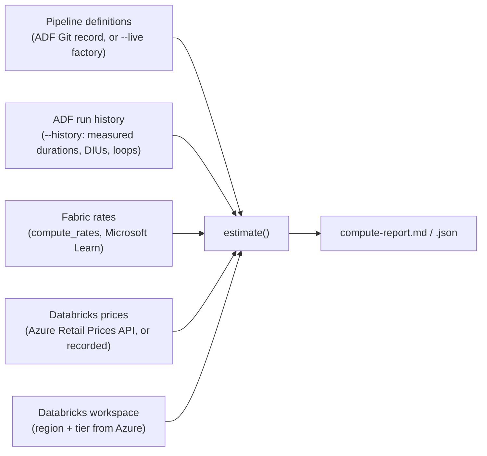

# Compute assessment and Azure Databricks (external compute)

This document covers how the tool sizes Fabric compute for migrated pipelines, and how Spark work runs on Azure
Databricks as external compute. It explains the cost model and the Databricks setup for this engagement.

- Code: `src/adf2fabric/agent/assessment/` (`compute.py`, `compute_rates.py`, `azure_prices.py`, `adf_history.py`, `agent.py`)
- Command: `adf2fabric assess-compute`
- Tests: `tests/test_compute.py`

## 1. What it answers

| Question | Answer from the tool |
|---|---|
| How much Fabric capacity do the pipelines need? | CU-seconds per activity, CU-hours per day, and the smallest F SKU that fits |
| What does Spark on Databricks cost? | DBUs and VM cost per run, per day and per month, separate from Fabric |
| Where did each number come from? | Every number is labelled: measured (ADF run history) or assumed (a stated default); live or recorded price |

## 2. How the estimate is built



**Per activity, by how ADF bills it:**

| Activity | Fabric meter | Rule |
|---|---|---|
| Copy | Data movement | 1.5 CU-hours per throughput-hour (ITO). Billed per started minute (measured in ADF and in Fabric). |
| Lookup, Get Metadata, Script, … | Orchestration | 0.0056 CU-hours per run |
| Control activities (Wait, If, ForEach, Execute pipeline, …) | Orchestration | 0.0056 CU-hours per run |
| Mapping data flow | Spark | cores ÷ 2 CU for the run time (an upper estimate) |
| Synapse notebook / Spark job | Spark | Becomes a Fabric notebook: Medium node, 8 vCores = 4 CU |
| **Databricks notebook / jar / python** | **Orchestration only** | **The Spark compute is external: billed by Databricks (§3)** |

**Runs per day:**
- Pipelines with a trigger take their runs from it, and pass them down to the pipelines they invoke.
- Pipelines without a trigger default to `--runs-per-day`.

**SKU rule:**
- Pipelines are background operations, smoothed over 24 hours.
- Average CU = daily CU-hours ÷ 24, plus 25% headroom.
- The SKU is the smallest F that covers it.

**Run history (`--history`):**
- Read-only queries of the factory's last runs.
- They replace assumed durations, loop counts and DIUs with measured ones.
- Only runs where an activity had its current type count. For example, runs from when a Databricks activity was still
  a Wait placeholder are left out.

## 3. Databricks as external compute

**Cost per activity run:**

```
nodes × cluster hours × (DBUs per node-hour × DBU price + VM price per hour)
```

| Input | Where it comes from |
|---|---|
| Node type, workers | The activity's linked service (`newClusterNodeType`, `newClusterNumOfWorker`). Autoscale is estimated at the minimum. |
| Cluster hours | The activity's run time, which includes job-cluster start-up: measured (history) or 600 s assumed |
| Region, tier | The Databricks workspace (`workspaceResourceId`), read from Azure |
| DBU price, VM price | The Azure Retail Prices API for that region, tier and VM size (`--prices live`, the default), in USD and INR. `--prices recorded` uses the table in `compute_rates.py`. |
| DBUs per node-hour | `compute_rates.DATABRICKS_DBU_PER_NODE_HOUR`. It isn't in the price API, so it's confirmed from Databricks usage (`system.billing.usage`). |

**Limits:**
- An existing all-purpose cluster is billed by uptime, so it isn't estimated per run.
- An unknown VM size or region is reported, not guessed.

## 4. Databricks setup for this engagement

| Item | Value |
|---|---|
| Workspace | `dbw-adf-migration`, Premium, Central India, resource group `adf_to_fabric` (subscription `dbd817b4…`) |
| URL | `https://adb-7405618998257241.1.azuredatabricks.net` |
| Storage access | Unity Catalog storage credential `adls_datamigrationadftofabric` (the workspace access connector's managed identity, Storage Blob Data Contributor on `datamigrationadftofabric`) and external location `migration_test_spark` → `abfss://migrationcontainer@datamigrationadftofabric.dfs.core.windows.net/migration-test/spark-test`. Workspace users have READ FILES and WRITE FILES. |
| Cluster policy | `adf-migration-single-node` (`0018796FECE9BEFE`): job cluster, single node, `Standard_D4ds_v5` (4 vCPU, 16 GB), DBR 15.4 LTS, Unity Catalog single-user. Every cluster started by ADF or Fabric uses it. |
| Notebooks | `/Shared/adf-migration/NB_Read_Raw_Data`, `/Shared/adf-migration/NB_Transform_Cab_Data` (source in `databricks/notebooks/`) |
| ADF | Linked service `LS_Databricks` (factory managed identity, which has Contributor on the workspace). `PL_Spark_Test` has 2 `DatabricksNotebook` activities (Git `Synapse_to_adf`, published). |
| Fabric | Connection to the workspace and `PL_Spark_Test` with Azure Databricks activities: see §5 |

## 5. Measured runs

| Run | Activity | Cluster up | Notebook | Result |
|---|---|---|---|---|
| ADF `PL_Spark_Test` (16 Oct) | Generate_CSV_And_Parque → NB_Read_Raw_Data | 458 s | 42 s | Succeeded |
| | Transform_Parquet → NB_Transform_Cab_Data | 157 s | 41 s | Succeeded |

**Billing:**
- ADF billed each activity as **ExternalActivity** (0.15 h and 0.05 h on the Azure IR).
- The Spark compute is billed by Databricks.

## 6. Results (adf-data-migration-7593)

| | Value |
|---|---|
| Fabric compute, 12 pipelines | 0.88 CU-hours/day, so **F2** |
| Databricks, `PL_Spark_Test` per run | ≈ ₹9.55 (≈ $0.10). Most of it is job-cluster start-up. |
| Databricks per month (1 run/day) | ≈ ₹286 (≈ $3) |

## 7. Run it

```bash
adf2fabric assess-compute --project <project> --live --history \
  --subscription <sub> --resource-group <rg> --factory <factory>      # live definitions, measured runs, live prices
adf2fabric assess-compute --project <project> --prices recorded        # offline: Git record, recorded prices
```

The report is written to `projects/<project>/assessment/compute-report.md` and `.json`.
