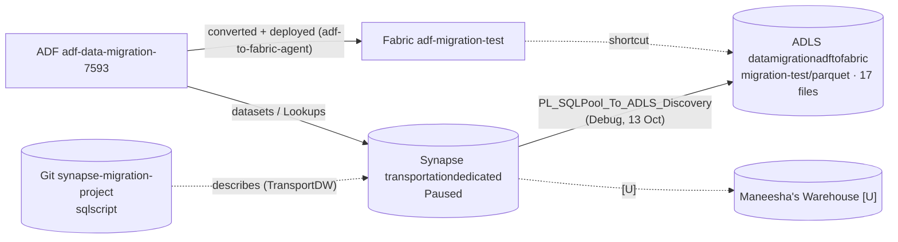

# Warehouse migration: current-state assessment (Phase 0–1)

The evidence base for the warehouse migration framework, with the first source being the Synapse dedicated SQL pool and the target an approved Fabric Warehouse.

**Status: assessment only.** No framework code exists yet, and no source, ADF or Fabric resource has been changed.
Labels: **[V]** verified on 2026-10-15 (read-only, from the live resource or the file named); **[I]** inferred; **[U]** unknown or blocked.

## 1. Evidence register

| Source of evidence | Version read | Access | What it gives |
|---|---|---|---|
| Synapse workspace `transportationmigration` (sub `00718529…`, tenant `b886bb14…`) | live ARM, 2026-10-15 | Read (ARM) | Workspace, endpoint, pool state |
| SQL pool `transportationdedicated` | — | **None: pool Paused** | No catalog query possible |
| `maneesha26625/synapse-migration-project`, `sqlscript/` | `origin/main` `bfb7ed0` | Git read | Offline DDL: schemas, tables, external tables, indexes, views, procs |
| ADLS `datamigrationadftofabric` / `migrationcontainer/migration-test/parquet/` | listing, 2026-10-15 | Read (account key via ARM, held in memory) | 17 Parquet exports of 13 Oct |
| ADF `adf-data-migration-7593` (sub `dbd817b4…`, RG `adf_to_fabric`) | live ARM, 2026-10-15 | Reader | Pipelines, datasets, linked services, triggers, IRs |
| `simple3957/Synapse_to_adf` (Git of the factory above) | `main` `360e17a` | Git read | Same definitions as live |
| ADF `sathvik-df` (sub `da8bc354…`, RG `datafactory-rg154`) | live ARM, 2026-10-15 | Read; subscription disabled | Stale copy |
| `simple3957/adf-discovery` | `origin/main` `0cdbb25` | Git read | CLI exports of `sathvik-df` (5 Oct) |
| Fabric tenant pal.tech (`1680abbe…`) as `sathvik.kamegaonkar@pal.tech` | REST, 2026-10-15 | Workspace member | Workspaces and items |
| `maneesha26625/synapse_fabric_migration_project` | `main` `b6a85f4` | Git read (no LICENSE) | Reference implementation of Synapse → Fabric Warehouse |

## 2. Source: Synapse dedicated SQL pool
- **[V]** Endpoint `transportationmigration.sql.azuresynapse.net`; pool `transportationdedicated`, **DW100c, Paused**. The subscription is Enabled with its spending limit on, and its credits are reported as nearly used up.
- **[V]** The DDL scripts target database `TransportDW` on server `transportationsynapsemigration`, **not** the live pool. They are evidence of design, not proof of the live schema.

**Objects in the export** (`sys.objects` type U, V, ET, exported 13 Oct to `<schema>_<object>.parquet`):

| Schema | Object | Kind | DDL in Git | Synapse-specific features in the DDL |
|---|---|---|---|---|
| dw | DimCabType | base table [V] | yes | REPLICATE, CCI |
| dw | DimLocation | base table [V] | yes | REPLICATE, CCI, `IDENTITY(1,1)` |
| dw | DimPaymentType | base table [V] | yes | REPLICATE, CCI |
| dw | DimRate | base table [V] | yes | REPLICATE, CCI |
| dw | DimTripType | base table [V] | yes | REPLICATE, CCI |
| dw | DimVendor | base table [V] | yes | REPLICATE, CLUSTERED INDEX (VendorKey) |
| dw | FactCabTrip | base table [V] | yes | HASH(PULocationKey), CCI, 2 nonclustered indexes; `datetime`, `tinyint` columns |
| dw | SalesByCityProduct | **[U]** (base table assumed) | **no** | unknown |
| stage | NYCCabTrip_Green | base table [V] | yes | ROUND_ROBIN, CCI, `varchar(8000)` |
| stage | NYCCabTrip_Yellow | base table [V] | yes | ROUND_ROBIN, CCI, `varchar(8000)` |
| stage | External_NYCCabTrip_Green | external table [V] | yes | PolyBase (HADOOP data source, Parquet format, REJECT_VALUE) |
| stage | External_NYCCabTrip_Yellow | external table [V] | yes | same |
| stage | TaxiZoneLookup | **[U]** | **no** | unknown |
| operation | MetadataTableControl | base table [V] | yes | default distribution; `datetime` |
| operation | PipelineRunLog | **[U]** | **no** | unknown |
| operation | vw_CabSourceSummary | view [V] | yes (`views.json`) | — |
| operation | vw_MigrationObjectCounts | view [V] | yes (`views.json`) | — |

- **"17 objects"** = 13 base tables + 2 external tables + 2 views. **[I]** The three unscripted objects are counted as base tables because they appear in the export and are not views or external tables in any script. This needs a live or owner check.
- **[V]** **Stored procedures** `operation.usp_CabDataAssessment` and `operation.usp_CabDataValidation` (`SQL script 1.json`) were **not** exported (type P is excluded by the export query).
- **[V]** **Server-level objects in the DDL:** master key, external data source `transportdw_transportationmigration_dfs_core_windows` (credential `SynapseManagedIdentity`, not created in any script), file format `SynapseParquetFormat` (not created in any script).
- **[U]** Row counts, functions, partitions, statistics, security (users, roles, RLS), and the real types of the unscripted objects.

**Data export risks [V]** (`PL_SQLPool_To_ADLS_Discovery`, Debug run, no triggered run recorded):
- `allowDataTruncation: true`;
- ForEach runs on Lookup `Completed`;
- external tables were read through PolyBase, and both point at the same folder;
- files land beside unrelated test data in `migration-test/parquet/`.

## 3. Azure Data Factory
- **[V] Authoritative factory: `adf-data-migration-7593`.** Live has 12 pipelines, 25 datasets, 6 linked services, 1 trigger (`TR_Schedule_MigrationTest`, daily, Stopped) and 1 IR (`integrationRuntime7593`). This equals Git `Synapse_to_adf` `main` `360e17a`.
- **[V] `sathvik-df`:** 4 pipelines, 9 datasets, 5 linked services, 0 triggers, 3 IRs. Its subscription is disabled. **It shares the Git repo and the `adf_publish` branch** with the factory above.
- **[V] `adf-discovery` exports** are flattened, UTF-16 `az` CLI output of `sathvik-df` as of 2026-10-05, and contain no SQL discovery. They are **outdated** and not used as evidence for the current factory.

### Linked services pointing at the warehouse

| Linked service | Server / database | Auth | Note |
|---|---|---|---|
| `AzureSynapseAnalytics1` | `transportationmigration…` / `transportationdedicated` | SQL login | Used by the discovery/export pipeline |
| `transportationsynapsemigration-WorkspaceDefaultSqlServer` | `transportationmigration…` / `@{linkedService().DBName}` | SQL login | **`DBName` is not supplied by any dataset** |

### ADF → warehouse references

| ADF asset | Kind | Objects | Resolution |
|---|---|---|---|
| `DS_SQL_DimLocation`, `…DimPaymentType`, `…DimRate`, `…DimTripType`, `…DimVendor`, `…FactCabTrip` | dataset | `dw.*` (same names) | static [V] |
| `DS_SQL_NYCCabTrip_Green` / `_Yellow` | dataset | `stage.NYCCabTrip_*` | static [V] |
| `DS_SQL_DimCabType` | dataset | **table missing from the definition** | broken [V] |
| `DS_SQL_DynamicTable` | dataset | `@dataset().SchemaName/TableName` | dynamic, unresolved |
| `AzureSynapseAnalyticsTable1` | dataset | `dw.DimLocation` (overridden by the query) | static |
| `AzureSynapseAnalyticsTable2` | dataset | `dw.DimCabType`; parameters `pSchema`/`pTable` declared but unused | static plus a dead parameter |
| `PL_SQL_Data_Assessment` (9 Lookups) | query text | 7 `dw` tables, 2 `stage` tables | static [V] |
| `PL_SQL_Data_Validation` (3 Lookups) | query text | `dw.FactCabTrip`, `stage.NYCCabTrip_*` | static [V] |
| `PL_ControlFlow_Test` | ForEach items | `dw.FactCabTrip`, `stage.NYCCabTrip_*` (as names) | static literals [V] |
| `PL_SQLPool_To_ADLS_Discovery` | Lookup over `sys.objects` → ForEach → Copy `SELECT *` | every U, V, ET object at run time | dynamic: means "all" |

**Classification so far** (to be produced by the analyzer in Phase 2):
- **Direct:** the 7 `dw` dimensions and fact, plus the 2 `stage` tables.
- **Dynamic (all objects):** the export pipeline.
- **Indirect:** the views (they read the `dw` and `stage` tables) and the procs (they read the views).
- **Standalone (no ADF reference):** `operation.MetadataTableControl`, `operation.PipelineRunLog`, `dw.SalesByCityProduct`, `stage.TaxiZoneLookup`, and the 2 external tables.
- **[U]** Who calls the procs, and whether the control table drives any live pipeline. No ADF activity references them.

## 4. Fabric
- **[V]** Tenant pal.tech, workspaces `adf-migration-test` (12 pipelines, Lakehouse `LH_Migration` with a shortcut to `migrationcontainer`, 2 notebooks) and `adf-to-fabric-migration-test` (an older copy of 10 pipelines). **No Warehouse is visible to our account.**
- **Target Warehouse (provided 2026-10-15):**
  - Workspace **`Synapse_to_Fabric`** (`28015cae-f0df-4a98-97e1-e7f31b7c7b2d`)
  - Warehouse **`transportationdedicated`**
  - SQL endpoint `vi3gyq6jqvouvcy6poscqw6oqi-vzoackg76cmevf7b47zrw7d3fu.datawarehouse.fabric.microsoft.com`
- **[V]** `GET /v1/workspaces/28015cae…` as `sathvik.kamegaonkar@pal.tech` returns **403 InsufficientPrivileges** (not 404). The workspace exists, and it is **[I] in the pal.tech tenant**. **Our account has no workspace role yet**, so its items, contents, capacity and collation are **[U]** until access is granted.
- **[I]** The name `transportationdedicated` matches how Maneesha's tool names Warehouses (after the source pool), so it was most likely created by that tool. Whether it is complete, partial or empty is **[U]**.
- **[V] Tenant:** the SQL endpoint name decodes to tenant **`436c36aa-85c9-4a5d-8b1e-7ba4285bce82`**, which is **not pal.tech**. `sathvik.kamegaonkar@pal.tech` is a **guest** there. With a token issued for that tenant, `GET /workspaces/28015cae…` returns 200. (The earlier 403 came from using a pal.tech token.) Capacity `2df079d3-…`.
- **[V] Workspace `Synapse_to_Fabric` items:**
  - Warehouse `transportationdedicated` (`bd9ed484-…`), created 2026-10-14 09:21 UTC, collation `Latin1_General_100_CI_AS_KS_WS_SC_UTF8`
  - Lakehouse `transportationdedicated_lakehouse`
  - 9 pipelines, incl. `load_transportationdedicated_wave_2` and `PL_Cab_Data_Ingestion`
  - 16 notebooks, incl. `schema`, `schema_extensions`, `views`, `stored_procedures`, `procedures_assessment`
  - 2 Spark job definitions; 1 environment

  These names match Maneesha's tool, which created the Warehouse.
- **[V] Warehouse contents** (read-only SELECT over the SQL endpoint, Entra token, 2026-10-15): 23 user objects, all created 2026-10-14.

| Object | Kind | Warehouse rows | Export rows (13 Oct) | Result |
|---|---|---|---|---|
| dw.DimCabType / DimLocation / DimPaymentType / DimRate / DimTripType / DimVendor | table | 2 / 47 / 6 / 6 / 3 / 2 | same | **match** (rows and column count) |
| dw.FactCabTrip | table | 9 804 | 9 804 | **match** |
| dw.SalesByCityProduct | table | 5 | 5 | **match** (no DDL in Git; the definition is in the Warehouse) |
| stage.NYCCabTrip_Green / _Yellow | table | 4 898 / 4 906 | same | **match** |
| stage.TaxiZoneLookup | table | 47 | 47 | **match** (no DDL in Git) |
| operation.MetadataTableControl | table | 52 | 52 | **match** |
| operation.PipelineRunLog | table | **38** | **21** | **migrated correctly** [V]. All 21 exported rows are present unchanged (no duplicates). The 17 extra rows were logged in Fabric on 2026-10-14 between 11:34 and 11:48 UTC, after the Warehouse was created, by Fabric pipeline and procedure runs (`usp_ValidateFactLoad`, `RowCount:*`, `Log_Start`, `SQL_Object_Assessment`; `PipelineName` holds Fabric item IDs). Maneesha confirms the source has no new entries. |
| operation.vw_CabSourceSummary, vw_MigrationObjectCounts | view | – | – | present; definitions not compared yet |
| stage.External_NYCCabTrip_Green / _Yellow | external table | – | 4 898 / 4 906 | **not migrated** (PolyBase is not supported in Fabric Warehouse); same data as the `stage.NYCCabTrip_*` tables |
| operation.usp_CabDataAssessment, usp_CabDataValidation | proc | – | not exported | present |
| operation.usp_LoadDimLocation, usp_LoadFactCabTrip, usp_LoadStageCabTrips, usp_LogPipelineRun, usp_ValidateFactLoad | proc | – | – | **extra**: not in any source script (created 14 Oct 11:39) |
| migration_load.dw__DimLocation | table | 0 | – | extra: staging table from Maneesha's tool |

- **Conclusion so far [V]:** the existing Warehouse already contains **all 13 base tables, with every exported row present and column counts matching against the 13 Oct export**. 12 are exact; `PipelineRunLog` additionally holds 17 log rows written in Fabric afterwards. Both views and the procedures are also present. The 2 external tables are not migrated (by platform limitation).
- **Not yet verified:** column types, the view and procedure definitions against the source, per-column aggregates, and live source counts (pool paused).
- **Inspection prerequisites [V]:** ODBC Driver 18 is installed on this machine; `pyodbc` and `pyarrow` were installed into the project venv for this read-only check.

## 5. Current architecture (verified flows)

## 6. Security finding
`synapse-migration-project/sqlscript/external_tables.json` contains a **plaintext `CREATE MASTER KEY` password**.

**Owner decision (Maneesha, 2026-10-15):** it is left as is. Real client source scripts will contain secrets like this, and the migration must be designed for that. Rotation is the owner's choice.

**Framework requirement (applies to every source adapter):**
- **Detect** secret material in source artifacts:
  - `CREATE MASTER KEY … PASSWORD`
  - `CREATE DATABASE SCOPED CREDENTIAL … SECRET`
  - `IDENTITY/SECRET` in `COPY`/`OPENROWSET`
  - SAS tokens
  - connection strings with `PWD`/`Password`
  - account keys
- **Mask** it before anything is stored. The catalog, manifest, reports, logs and test output never contain the value. Reuse `connections/redaction.py` (`redact`) and the secret markers in `adf_semantic/parser.py`.
- **Never deploy it.** A Fabric Warehouse has no master key or PolyBase credential, so these statements become **"manual: not applicable in Fabric"** entries. Any real credential is re-created by its owner in Fabric connections or Key Vault.
- **Test it:** a fixture script with a fake password, with a test asserting the value never appears in any output file. This follows the existing "sentinel" tests in `test_adf_semantic_discovery.py`.

This document never reproduces the value.

## 7. Phase 0 checklist (gate G0)

| # | Item | Owner | Status |
|---|---|---|---|
| 1 | Source mode: **live** (resume Synapse, credits) or **offline** (13 Oct exports; counts unverified) | Lead | **decided: offline** (2026-10-15) |
| 2 | Name the target tenant, workspace and Warehouse; confirm capacity | Lead / admin | **named**: `Synapse_to_Fabric` / `transportationdedicated` (capacity [U]) |
| 3 | Access to the target workspace for our account (`sathvik.kamegaonkar@pal.tech`, guest in tenant `436c36aa…`) | Maneesha | **done**: read works (role level to be confirmed for writes) |
| 4 | Maneesha's Warehouse: contents, load date, creating tool, sync on/off | Maneesha | **contents and date verified** (§4); confirm the tool, whether sync is on, the extra `PipelineRunLog` rows, and the 5 extra procedures |
| 5 | Permission to reuse code from `synapse_fabric_migration_project` | Maneesha | **granted** (2026-10-15, confirmed via Bhavana; record it in writing in the repo or a PR) |
| 6 | DDL for `dw.SalesByCityProduct`, `stage.TaxiZoneLookup`, `operation.PipelineRunLog` | Maneesha | open |
| 7 | Committed master-key password | Maneesha | **owner decision: left as is**. Treated as real-world input; the framework must detect, mask and never deploy secrets (§6) |
| 8 | Confirm `adf-data-migration-7593` is authoritative; plan to disconnect `sathvik-df` from Git | Sathvik | open |
| 9 | Fetch the latest evidence repos (`bfb7ed0`, `0cdbb25`) | Us | **done** |

## 8. Decisions requiring approval
- **D1:** ~~source mode~~ **Decided: offline.** Source = Git DDL (`synapse-migration-project` `bfb7ed0`) plus the 13 Oct Parquet exports. Reports must state that source counts are as of 13 Oct and are not live-verified.
- **D2:** target Warehouse.
- **D3:** ~~reuse Maneesha's modules, or treat them as a reference only~~ **Decided: reuse is permitted.** Her modules will be adapted behind the generic interfaces, with provenance noted in the code.
- **D7:** ~~where the SQL pipelines run~~ **Decided: cross-tenant.** The SQL pipelines stay in pal.tech (`adf-migration-test`) and connect to the Warehouse in tenant `436c36aa…`. To be verified in Phase 7 **[I]**:
  - **Connection:** a Fabric SQL connection to the Warehouse SQL endpoint (`vi3gyq6jqvouvcy6poscqw6oqi-…datawarehouse.fabric.microsoft.com`, database `transportationdedicated`). It cannot be a same-tenant "Warehouse item" reference.
  - **Authentication:** a **service principal registered in tenant `436c36aa…`**, granted access to the `Synapse_to_Fabric` workspace (Viewer to read; Contributor if pipelines write), with the tenant setting that allows service principals to use Fabric enabled by that tenant's admin. Its secret is supplied only as a reference, never stored. An organizational-account (OAuth) connection with the guest account is the alternative, if the target tenant allows it.
  - **Prerequisites from Maneesha's tenant admin:** the app registration, a client secret or certificate, workspace role, and the tenant setting.
- **D4:** scope of indirect and standalone objects, and the handling of external tables, master key and data source.
- **D5:** default conflict policy (`fail`), and whether `replace` is allowed.
- **D6:** whether ADF changes are allowed in Phase 7.

Full plan, phases and gates: see `ARCHITECTURE_AND_MIGRATION.md` (to be created in Phase 3).
